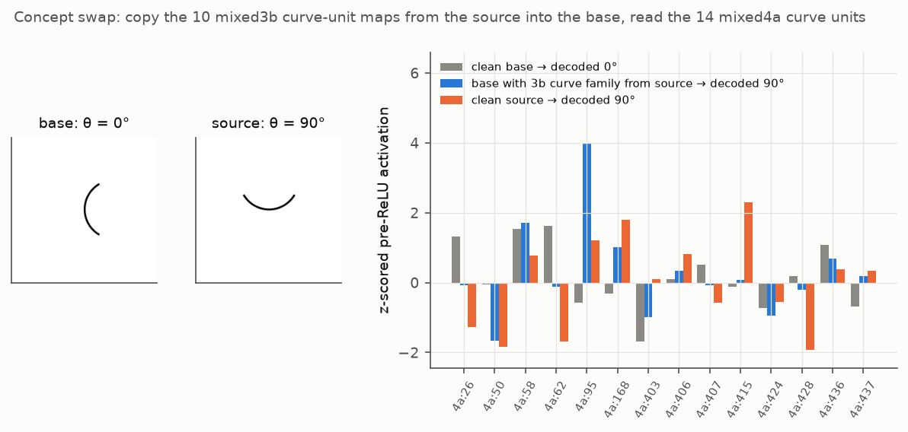
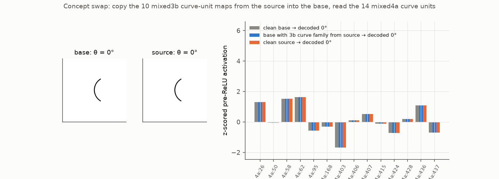
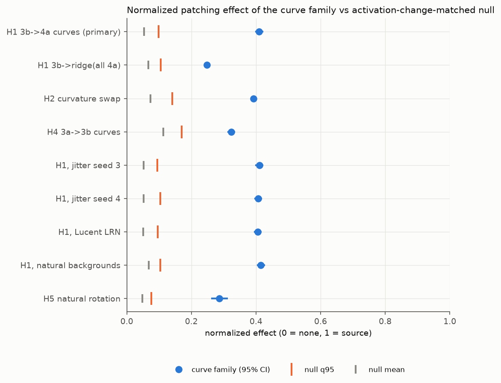
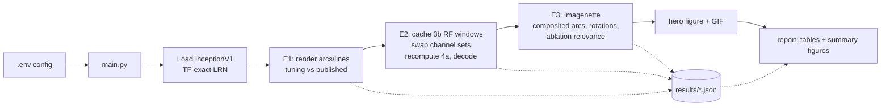

# Counterfactual concept swaps on InceptionV1 curve detectors

Do the famous **curve-detector neurons** of InceptionV1 ([Cammarata et al. 2020](https://distill.pub/2020/circuits/curve-detectors/))
actually *carry* curve orientation to the rest of the network, or do they only *correlate* with it?

This repo answers with **counterfactual interchange interventions**, also called concept swaps or activation patching,
in the style of [Huang et al. 2023](https://arxiv.org/abs/2309.10312) and [Bäumel et al. 2025](https://arxiv.org/abs/2508.02513):
1. Take two images that differ **only** in curve orientation.
2. Copy the 10 `mixed3b` curve units' activations from the *source* image into the *base* image.
3. Check whether the next layer's curve units now represent the source orientation.
4. Compare the curve family against thousands of matched control neuron sets, using a pre-registered decision rule.



*A fixed example, chosen by rule and not by outcome (base θ=0°, source θ=90°, radius 45, width 3, dark-on-light).
Left: the base and source arcs. Right: the 14 published `mixed4a` curve units for the clean base (gray), the base
with the 3b curve family copied from the source (blue), and the clean source (orange). This pair happens to transfer
(decoded 90°), but only 17.7% of pairs do. The animation sweeps the source orientation and shows many failures.*



## Results
Every hypothesis, metric and threshold was pre-registered before the confirmatory run. All numbers below come from
[`reports/generated/results.md`](reports/generated/results.md), with 95% pigeonhole-bootstrap CIs.

| Test | IIA family | Matched-null q95 | Effect family | Matched-null q95 | Verdict |
|---|---|---|---|---|---|
| E1: tuning vs published (3b / 4a) | r = 0.969 / 0.847 | 0.254 / 0.242 | — | — | replicated |
| **H1 primary: 3b curve family → 4a curve units** | **0.177** [0.156, 0.199] | 0.001 | **0.410** [0.400, 0.420] | 0.098 | **falsified** (IIA < 0.2) |
| H1-ridge: → all 508 `mixed4a` channels | 0.105 [0.087, 0.123] | 0.000 | 0.248 | 0.106 | supported* |
| H2 curvature swap (line ↔ arc) | 0.405 [0.371, 0.440] | 0.054 | 0.393 | 0.141 | supported* |
| H4 3a → 3b curve circuit | 0.058 [0.045, 0.071] | 0.005 | 0.324 | 0.169 | supported* |
| Composited arcs on Imagenette photos | 0.190 [0.169, 0.211] | 0.001 | 0.415 | 0.104 | supported* |
| H5 natural rotation counterfactual | 0.072 [0.054, 0.091] | 0.000 | 0.287 | 0.075 | supported* |

\* Secondary criterion: the effect margin over the activation-change-matched null has a CI above 0 and a
Holm-adjusted p ≤ 0.004.

**Robustness.** Jitter seeds 3 and 4 give IIA 0.172 and 0.171; Lucent's default LRN gives 0.172. Every verdict is
unchanged.

**Takeaways.**
- **The curve family is a highly specific causal mediator.**
  - The best of 4000 activation-change-matched and branch-matched sets of 10 channels transfers orientation in
    only 0.13% of pairs.
  - The family moves the next layer's curve code 41% of the way to the source.
  - Mean-ablating the family changes Imagenette top-1 predictions on 17.2% of photos, versus 9.3% for matched
    ablations (p = 0.0099).
- **It is not sufficient.** The pre-registered strong claim fails.
  - The orientation code is distributed and redundant: the other 470 channels transfer it in 40% of pairs, and
    about 80 channels are needed for IIA ≈ 0.8.
  - Effects add roughly linearly, at about 0.04 per curve unit.
- **The family carries curvature, not just orientation.** Inserting its arc activations into a line image makes
  the 4a curve units read "arc" in 81% of pairs.

Full write-ups:
- [`reports/summary.md`](reports/summary.md): plain-language summary and glossary.
- [`reports/all_experiments.md`](reports/all_experiments.md): story and learnings.
- Per-experiment reports for [E1](reports/e1_replication.md), [E2](reports/e2_synthetic.md) and [E3](reports/e3_natural.md).
- The paper: [`reports/paper/paper.pdf`](reports/paper/paper.pdf).
- The per-pair data: Hugging Face dataset [BurnyCoder/inceptionv1-curve-concept-swaps](https://huggingface.co/datasets/BurnyCoder/inceptionv1-curve-concept-swaps).



## Methodology
**Model.** Pretrained InceptionV1 (Lucid "inception5h") loaded with [Lucent](https://github.com/greentfrapp/lucent).
- Its LRN layers are patched to the TensorFlow-exact constants
  ([lucent#51](https://github.com/greentfrapp/lucent/pull/51)).
- Nothing is trained.

**Explanation under test.**
- `mixed3b` units `379, 406, 385, 343, 342, 388, 324, 340, 330, 349` are orientation-tuned curve detectors.
- Their published tuning curves, together with the 3a and 4a curve families, are in `data/circuits/` (CC-BY 4.0).

**E1, observational gate.**
- Reproduce the published tuning curves with our renderer, fitting the orientation convention on 3a only.
- Test against a permutation null.

**E2, synthetic interventions.**
- Stimuli: 1152 arcs per split (72 orientations × 4 radii × 2 widths × 2 polarities), in 4608 base/source pairs
  that differ only in orientation.
- Swap the curve family's 11×11 receptive-field window and recompute `mixed4a`.
- Readout τ: a nearest-template orientation decoder over the 14 published `mixed4a` curve units. The secondary,
  non-circular readout is a ridge decoder over all 508 `mixed4a` channels.
- Metrics:
  - **IIA**: how often the decoded orientation becomes the source's.
  - A **normalized effect** from 0 to 1.
- Controls:
  - 2000 **activation-change-matched** null sets.
  - 2000 **branch-matched** null sets.
  - Fisher top-10, the complement and all channels.
- Secondary tests: H2, a curvature swap (line ↔ arc); H4, the 3a → 3b curve circuit.
- Robustness: two extra jitter seeds and the default-LRN model.

**E3, natural images (Imagenette).**
- Arcs composited onto photos.
- H5, a **natural rotation counterfactual**: the source is the same photo rotated about the receptive-field centre.
- An end-to-end relevance check: mean-ablate the family and count changes to the 1008-way prediction.

**Statistics.**
- Pigeonhole bootstrap over base and source images ([Owen 2007](https://doi.org/10.1214/07-AOAS122)).
- Phipson–Smyth permutation p-values.
- Holm correction across the five secondary hypotheses.
- Every rule was fixed in [`reports/preregistration.md`](reports/preregistration.md) before any confirmatory run.

Further reading:
- Why each choice was made: [`docs/methodology.md`](docs/methodology.md).
- Prior work: [`docs/literature_review.md`](docs/literature_review.md).

## Quick start
```bash
git clone https://github.com/BurnyCoder/counterfactually-causal-analysis-of-convolutional-neural-networks-with-concept-swaps
```
```bash
cd counterfactually-causal-analysis-of-convolutional-neural-networks-with-concept-swaps
```
```bash
uv sync
```
```bash
cp .env.example .env
```
```bash
uv run pytest -q
```
```bash
uv run python main.py --quick
```
```bash
uv run python main.py
```

- `uv sync` installs Python 3.12, torch 2.14 (CUDA 13.0 wheels) and Lucent from git.
- `pytest` runs 27 tests. It downloads `inception5h.pth` (28 MB) on first use.
- `--quick` is a smoke test of the whole pipeline, taking about 5 minutes. It uses separate seeds and writes to
  `results/quick/`.
- The full run takes about 1 hour on an RTX 5070 Laptop. E3 downloads Imagenette-320 (342 MB) once.

To redo a single phase, use `uv run python main.py --phase {e1,e2,e3,hero,report}`. Later phases read earlier
phases' results from `results/*.json`. The run is configured through `.env`; see `.env.example`. A CPU run works
with `DEVICE=cpu` but is much slower. Windows notes are in [`docs/reproducibility.md`](docs/reproducibility.md).

## What happens when you run it

1. **E1** renders 2304 selection-split stimuli, reads `mixed3a`/`mixed3b`/`mixed4a` at the readout position, and
   compares tuning curves with the authors' data.
2. **E2** caches, per stimulus, the `mixed3b` window feeding `mixed4a` unit (6,6). It then overwrites channel sets
   with the source's values and recomputes only `maxpool4 → mixed4a`. This is exact, as the fp64 unit test shows.
   Every neuron set (the family, references, and about 4500 null sets) is scored on every pair.
3. **E3** downloads Imagenette and repeats the swap on composited and rotated photos, then runs full-network
   ablations.
4. **Report** writes [`reports/generated/results.md`](reports/generated/results.md) and
   `figures/summary_*.png` from the JSONs. All numbers quoted in the reports come from there.

The module graph is in [`docs/architecture.md`](docs/architecture.md). Logs go to `logs/<timestamp>.log` and the
terminal.

## Features
- Interchange interventions over arbitrary channel sets of any Inception block. Patches are applied with forward
  hooks, or with a cropped-window recomputation verified exact against the full network.
- An anti-aliased parametric curve and line renderer, with factorial grids and counterfactual minimal pairs.
- A natural-image counterfactual based on rotating the photo about the readout unit's receptive-field centre.
- Activation-change-matched, branch-matched and random null neuron sets, plus a Fisher-score data-driven
  reference.
- Template and ridge orientation decoders, IIA, and a normalized projection effect.
- Pigeonhole bootstrap CIs, permutation p-values, Holm correction, and a pre-registered three-way verdict.
- Generated result tables, figures, a GIF and a LaTeX paper.

## Technologies
- PyTorch 2.14 (CUDA 13.0) and [Lucent](https://github.com/greentfrapp/lucent) (Lucid InceptionV1 port).
- NumPy, SciPy, pandas, scikit-learn (RidgeCV, AUROC), statsmodels (Holm) and Pillow (rendering).
- Matplotlib (figures, GIF) and python-dotenv.
- uv for the environment, pytest for tests, and pdflatex (MiKTeX) for the paper.

## Repository map
| Path | Contents |
|---|---|
| `main.py` | pipeline wrapper |
| `src/concept_swap/` | library modules (`model`, `stimuli`, `interventions`, `readouts`, `families`, `stats`, `natural`, `plots`) and `phases/` |
| `tests/` | 27 tests: LRN formula, block re-implementation, crop exactness, hook invariants, geometry, statistics |
| `data/circuits/` | the authors' published curve-family tuning data (CC-BY 4.0) |
| `results/`, `figures/` | outputs of the confirmatory run |
| `reports/` | pre-registration, per-experiment reports, all-experiments report, plain-language summary, paper (`reports/paper/paper.pdf`) |
| `docs/` | literature review, methodology rationale, architecture, reproducibility |

## Citation and authorship
Libor Burian, *Counterfactual concept swaps on InceptionV1 curve detectors* (2026), this repository. The code and
paper were written by Claude Code (Anthropic) executing Libor Burian's research idea; human cleanup is in progress.
The Circuits tuning data are © their authors (CC-BY 4.0).
