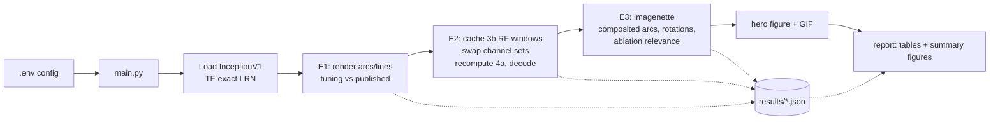

# Counterfactual concept swaps on InceptionV1 curve detectors

Do the famous **curve-detector neurons** of InceptionV1 ([Cammarata et al. 2020](https://distill.pub/2020/circuits/curve-detectors/))
actually *carry* curve orientation to the rest of the network, or do they only *correlate* with it?

This repo answers with **counterfactual interchange interventions**, also called concept swaps or activation patching,
in the style of [Huang et al. 2023](https://arxiv.org/abs/2309.10312) and [Bäumel et al. 2025](https://arxiv.org/abs/2508.02513):
1. Take two images that differ **only** in curve orientation.
2. Copy the 10 `mixed3b` curve units' activations from the *source* image into the *base* image.
3. Check whether the next layer's curve units now represent the source orientation.
4. Compare the curve family against thousands of matched control neuron sets, using a pre-registered decision rule.


*A fixed example, chosen by rule and not by outcome (base θ=0°, source θ=90°, radius 45, width 3, dark-on-light).
Left: the base and source arcs. Right: the 14 published `mixed4a` curve units for the clean base (gray), the base
with the 3b curve family copied from the source (blue), and the clean source (orange). This pair happens to transfer
(decoded 90°), but only 17.7% of pairs do. The animation sweeps the source orientation and shows many failures.*


## Results
Every interventional hypothesis, metric and threshold was pre-registered before the confirmatory run. E1 is a
descriptive gate without a pre-registered threshold. All numbers below come from
[`reports/generated/results.md`](reports/generated/results.md), with 95% pigeonhole-bootstrap CIs.

| Test | IIA family | Matched-null q95 | Effect family | Matched-null q95 | Verdict |
|---|---|---|---|---|---|
| E1: tuning vs published (3b / 4a) | r = 0.969 / 0.847 | 0.254 / 0.242 (permutation) | — | — | replicated (descriptive) |
| **H1 primary: 3b curve family → 4a curve units** | **0.177** [0.156, 0.199] | 0.001 | **0.410** [0.400, 0.420] | 0.098 | **falsified** (IIA < 0.2) |
| H1-ridge: → all 508 `mixed4a` channels | 0.105 [0.087, 0.123] | 0.000 | 0.248 | 0.106 | supported* |
| H2 curvature swap (line ↔ arc) | 0.405 [0.371, 0.440] | 0.054 | 0.393 | 0.141 | supported* |
| H4 3a → 3b curve circuit | 0.058 [0.045, 0.071] | 0.005 | 0.324 | 0.169 | supported* |
| Composited arcs on Imagenette photos | 0.190 [0.169, 0.211] | 0.001 | 0.415 | 0.104 | supported* |
| H5 natural rotation counterfactual | 0.072 [0.054, 0.091] | 0.000 | 0.287 | 0.075 | supported* |

\* Secondary criterion: the effect margin over the activation-change-matched null has a CI above 0 and a
Holm-adjusted p < 0.05 (all observed Holm-adjusted p ≤ 0.004).

**Robustness.** Jitter seeds 3 and 4 give IIA 0.172 and 0.171; Lucent's default LRN gives 0.172. Every verdict is
unchanged.

**Post-hoc checks** (not pre-registered; [`reports/posthoc_robustness.md`](reports/posthoc_robustness.md)) leave
every conclusion unchanged:
- **A stricter rank-matched null:** the H1 effect is 0.410, against a null q95 of 0.121.
- **The 10 non-family channels that change most** reach only 0.125 and transfer the decoded orientation in 1 of
  4574 pairs. The stronger, effect-ranked competitor (below) reaches 0.201.
- **The H1-ridge effect**, as pre-registered, is measured over all 508 z-scored channels. In the decoded
  orientation's (cos, sin) space it is 0.573.
- **Interpolation blur does not matter for H5.** On matched angles, exact and bilinear rotations give the same
  effect: 0.336 vs 0.335. An earlier claim of a larger blur-free effect (0.336 vs 0.287) compared different angle
  sets.

A second, independent audit found no methodological error and tested four claims post hoc: a causally ranked
competitor set, per-direction H2 nulls, a rank-matched ablation null and the ridge-readout complement. Their
overturning outcomes were set in the audit plan before the run, but were first committed with the results, so git
does not timestamp them. It also added a cross-nuisance sham. None overturned a conclusion. The audit did correct the earlier "redundant
code" wording, which held for only one of the two readouts (see below).

A third independent audit again found no error that invalidates a pre-registered finding. It committed its
overturning rules before its checks ran. Three outcomes:
- It withdrew the blur claim above.
- It confirmed the causal ranking under the whole-layer readout too.
- It narrowed the additivity claim (below).

**Takeaways.**
- **The curve family is a highly specific causal mediator,** compared with other `mixed3b` channels.
  - The best of 4000 activation-change-matched and branch-matched sets of 10 channels transfers orientation in
    only 0.13% of pairs.
  - The family moves the next layer's curve code 41% of the way to the source.
  - Ranking all 480 channels by their own patching effect (post hoc) puts 9 of the 10 published units in the top 10
    for the 4a curve units, and 8 of 10 for a decoder over all of `mixed4a`.
  - The 10 best non-family channels under these rankings reach only 0.201 and 0.211. The family reaches 0.410 and
    0.573.
  - Mean-ablating the family changes Imagenette top-1 predictions on 17.2% of photos, versus 9.3% for matched
    ablations (p = 0.0099).
- **It is not sufficient.** The pre-registered strong claim fails.
  - The rest of the orientation signal is spread over many channels: rankings by activation change or by single-channel effect need about 80 for
    IIA ≈ 0.8.
  - Whether those channels can replace the family depends on the readout.
    - Swapping the other 470 channels transfers the decoded orientation in 40% of pairs for the 4a curve units.
    - For a decoder over all of `mixed4a`, it transfers it in only 1.9% of pairs. There the family carries 57% of
      the decoded shift (post hoc).
  - Effects add almost exactly, at about 0.04 per curve unit.
    - For the 6 readout units in the 1×1 branch this is exact by architecture: max-pooling is per channel, followed
      by a linear 1×1 convolution.
    - For the 8 units in the 5×5 branch it is an empirical near-additivity (1.8% interaction), not a structural one.
- **The family carries curvature evidence.** Inserting its arc activations into a line image makes the 4a curve
  units read "arc" in 81% of pairs. Matched controls do so in 3% on average, and 95% of them in under 11.4%. The
  reverse swap rarely flips "arc" to "line" (0.3%). That asymmetry comes from the decoder, not the family: the family
  moves the readout about as far in each direction (effect 0.418 vs 0.367), and the correlation decoder's line/arc
  boundary sits less than halfway from the line template.

Full write-ups:
- [`reports/summary.md`](reports/summary.md): plain-language summary and glossary.
- [`reports/all_experiments.md`](reports/all_experiments.md): story and learnings.
- Per-experiment reports for [E1](reports/e1_replication.md), [E2](reports/e2_synthetic.md) and [E3](reports/e3_natural.md), plus the post-hoc [robustness checks](reports/posthoc_robustness.md).
- The paper: [`reports/paper/paper.pdf`](reports/paper/paper.pdf).
- The per-pair data: Hugging Face dataset [BurnyCoder/inceptionv1-curve-concept-swaps](https://huggingface.co/datasets/BurnyCoder/inceptionv1-curve-concept-swaps), in the collection [Counterfactual concept swaps in CNNs](https://huggingface.co/collections/BurnyCoder/counterfactual-concept-swaps-in-cnns-6adb89e08d92a1d8cb3e5583).
  Rebuild it with `uv run python main.py --phase export`, then upload `hf_export/`.


## Methodology
**Model.** Pretrained InceptionV1 (Lucid "inception5h") loaded with [Lucent](https://github.com/greentfrapp/lucent).
- Its LRN layers are patched to the TensorFlow-exact constants. The window is 11 = 2·depth_radius + 1 under
  [TF's LRN formula](https://www.tensorflow.org/api_docs/python/tf/nn/local_response_normalization), as also derived
  in [a comment on lucent#51](https://github.com/greentfrapp/lucent/pull/51#issuecomment-6345247394).
- Nothing is trained.

**Explanation under test.**
- `mixed3b` units `379, 406, 385, 343, 342, 388, 324, 340, 330, 349` are orientation-tuned curve detectors.
- Their published tuning curves, together with the 3a and 4a curve families, are in `data/circuits/` (CC-BY 4.0).

**E1, observational gate.**
- Reproduce the published tuning curves with our renderer, fitting the orientation convention on 3a only.
- Test against a permutation null.

**E2, synthetic interventions.**
- Stimuli: 1152 arcs per split (72 orientations × 4 radii × 2 widths × 2 polarities), in 4608 base/source pairs
  that differ only in orientation.
- Swap the curve family's 11×11 receptive-field window and recompute `mixed4a`.
- Readout τ: a nearest-template orientation decoder over the 14 published `mixed4a` curve units. The secondary,
  non-circular readout is a ridge decoder over all 508 `mixed4a` channels.
- Metrics:
  - **IIA**: how often the decoded orientation becomes the source's.
  - A **normalized effect** from 0 to 1.
- Controls:
  - 2000 **activation-change-matched** null sets.
  - 2000 **branch-matched** null sets.
  - Fisher top-10, the complement and all channels.
- Secondary tests: H2, a curvature swap (line ↔ arc); H4, the 3a → 3b curve circuit.
- Robustness: two extra jitter seeds and the default-LRN model.

**E3, natural images (Imagenette).**
- Arcs composited onto photos.
- H5, a **natural rotation counterfactual**: the source is the same photo rotated about the receptive-field centre.
- An end-to-end relevance check: mean-ablate the family and count changes to the 1008-way prediction.

**Statistics.**
- Pigeonhole bootstrap over base and source images ([Owen 2007](https://doi.org/10.1214/07-AOAS122)).
- Phipson–Smyth permutation p-values.
- Holm correction across the five secondary hypotheses.
- Every rule was fixed in [`reports/preregistration.md`](reports/preregistration.md) before any confirmatory run.

Further reading:
- Why each choice was made: [`docs/methodology.md`](docs/methodology.md).
- Prior work: [`docs/literature_review.md`](docs/literature_review.md).

## Quick start
```bash
git clone https://github.com/BurnyCoder/counterfactually-causal-analysis-of-convolutional-neural-networks-with-concept-swaps
```
```bash
cd counterfactually-causal-analysis-of-convolutional-neural-networks-with-concept-swaps
```
```bash
uv sync
```
```bash
cp .env.example .env
```
```bash
uv run pytest -q
```
```bash
uv run python main.py --quick
```
```bash
uv run python main.py
```

- Requires [uv](https://docs.astral.sh/uv/) ≥ 0.8.6, the first version with `extra-build-variables`.
- `uv sync` installs Python 3.12, torch 2.14 (CUDA 13.0 wheels) and Lucent from git.
- `pytest` runs 34 tests. It downloads `inception5h.pth` (28 MB) on first use.
- `--quick` is a smoke test of the whole pipeline. It takes under a minute on an RTX 5070 Laptop once Imagenette is
  downloaded. It uses separate seeds and writes to `results/quick/`.
- The full run takes about 1 hour on an RTX 5070 Laptop. E3 downloads Imagenette-320 (342 MB) once.

To redo a single phase, use `uv run python main.py --phase {e1,e2,e3,hero,report}`. Four phases run only when named: `--phase posthoc` (post-hoc robustness checks, about 22 min), `--phase audit` (post-hoc checks added by the second, independent audit, about 5 min), `--phase audit2` (checks added by the third audit, about 4 min) and `--phase export` (Hugging Face folder). Later phases read earlier
phases' results from `results/*.json`. To reproduce every number in the reports and the paper, run `main.py`, then
`--phase posthoc`, `--phase audit`, `--phase audit2` and `--phase report`. A single E2 or E3 phase starts a fresh random stream, so its null sets differ
from the full run's. They are statistically equivalent, but only the full run reproduces the reported numbers exactly. The run is configured through `.env`; see `.env.example`. A CPU run works
with `DEVICE=cpu` but is much slower. Windows notes are in [`docs/reproducibility.md`](docs/reproducibility.md).

## What happens when you run it

1. **E1** renders 2304 selection-split stimuli, reads `mixed3a`/`mixed3b`/`mixed4a` at the readout position, and
   compares tuning curves with the authors' data.
2. **E2** caches, per stimulus, the `mixed3b` window feeding `mixed4a` unit (6,6). It then overwrites channel sets
   with the source's values and recomputes only `maxpool4 → mixed4a`. This is exact, as the fp64 unit test shows.
   Every neuron set (the family, references, and about 4500 null sets) is scored on every pair.
3. **E3** downloads Imagenette and repeats the swap on composited and rotated photos, then runs full-network
   ablations.
4. **Report** writes [`reports/generated/results.md`](reports/generated/results.md) and
   `figures/summary_*.png` from the JSONs. All numbers quoted in the reports come from there.

The module graph is in [`docs/architecture.md`](docs/architecture.md). Logs go to `logs/<timestamp>.log` and the
terminal.

## Features
- Interchange interventions over arbitrary channel sets. Forward hooks can read or patch any layer. A cropped-window
  recomputation, verified exact against the full network, covers `mixed3a → mixed3b` and `mixed3b → mixed4a`.
- An anti-aliased parametric curve and line renderer, with factorial grids and counterfactual minimal pairs.
- A natural-image counterfactual based on rotating the photo about the readout unit's receptive-field centre.
- Activation-change-matched, branch-matched and random null neuron sets, plus a Fisher-score data-driven
  reference.
- Template and ridge orientation decoders, IIA, and a normalized projection effect.
- Pigeonhole bootstrap CIs, permutation p-values, Holm correction, and a pre-registered three-way verdict.
- Generated result tables, figures, a GIF and a LaTeX paper.

## Technologies
- PyTorch 2.14 (CUDA 13.0) and [Lucent](https://github.com/greentfrapp/lucent) (Lucid InceptionV1 port).
- NumPy, pandas, scikit-learn (RidgeCV, AUROC), statsmodels (Holm) and Pillow (rendering).
- Matplotlib (figures, GIF) and python-dotenv.
- uv for the environment, pytest for tests, and pdflatex (MiKTeX) for the paper.

## Repository map
| Path | Contents |
|---|---|
| `main.py` | pipeline wrapper |
| `src/concept_swap/` | library modules (`model`, `stimuli`, `interventions`, `readouts`, `families`, `stats`, `natural`, `plots`) and `phases/` |
| `tests/` | 34 tests: RF locality, LRN formula, block re-implementation, crop exactness, hook invariants, which 4a branches add patches exactly, geometry, exact rotations, null samplers, statistics |
| `data/circuits/` | the authors' published curve-family tuning data (CC-BY 4.0) |
| `results/`, `figures/` | outputs of the confirmatory run |
| `reports/` | pre-registration, per-experiment reports, all-experiments report, plain-language summary, paper (`reports/paper/paper.pdf`) |
| `docs/` | literature review, methodology rationale, architecture, reproducibility |

## Did any concept swaps succeed?
Yes, but only a minority of them. In the main test (H1), the swap made the 14 `mixed4a` curve units decode the
source's orientation in **17.7% of pairs**: 811 of 4,574 eligible pairs (out of 4,608), 95% CI 15.6–19.9%
([results.md](reports/generated/results.md?plain=1#L36)). The swap overwrites the base image's values of the 10
`mixed3b` curve units at every position of the 11×11 `mixed3b` window that feeds the `mixed4a` readout unit at
(6, 6), then recomputes only `maxpool4 → mixed4a` ([preregistration.md](reports/preregistration.md?plain=1#L65),
[model.py](src/concept_swap/model.py#L160), [interventions.py](src/concept_swap/interventions.py#L67)).

The control sets did much worse. The two pre-registered nulls have 2,000 sets each, and every set is 10 other
`mixed3b` channels ([preregistration.md](reports/preregistration.md?plain=1#L85)):
- **Δ-matched:** drawn so that their histogram over deciles of Δ equals the family's. Δ is each channel's mean
  squared base→source change in the window, measured on the selection split
  ([families.py](src/concept_swap/families.py#L32), [common.py](src/concept_swap/phases/common.py#L59)).
- **Branch-matched:** drawn from the other 86 channels of the `mixed3b` 5×5 branch, channels 320–415
  ([common.py](src/concept_swap/phases/common.py#L67), [preregistration.md](reports/preregistration.md?plain=1#L88)).

Across these 4,000 sets the mean success rate was **0.008%** (Δ-matched 0.011%, branch-matched 0.005%). The best
single set, a Δ-matched one, reached 0.13%, or 6 of 4,574 pairs (`null_iia` in `results/e2_synthetic.json`). A
descriptive third null of 500 random sets averaged 0.001% ([preregistration.md](reports/preregistration.md?plain=1#L90)).

Let D = IIA − the 95th percentile of the Δ-matched null
([preregistration.md](reports/preregistration.md?plain=1#L105-L111), [stats.py](src/concept_swap/stats.py#L62)).
- H1 is "supported" only if IIA ≥ 0.5, D ≥ 0.10, the CI lower bound of D > 0, and the same CI condition holds
  against the branch-matched null.
- It is "falsified" if the CI upper bound of D < 0.05, or if IIA < 0.2.

H1 is **falsified** by the IIA < 0.2 clause (0.177). The margin clause does not trigger: D's CI is [0.155, 0.198]
([results.md](reports/generated/results.md?plain=1#L36)).

**What counts as success.**
- The swapped base must decode to within 10° of what the clean source decodes to
  ([common.py](src/concept_swap/phases/common.py#L151), [preregistration.md](reports/preregistration.md?plain=1#L75)).
- The decoder z-scores the 14 units' pre-ReLU values. It picks the orientation whose template correlates best
  (Pearson) among the 72 selection-split templates of the pair's own nuisance cell: arc radius, line width and
  contrast polarity ([readouts.py](src/concept_swap/readouts.py#L31), [preregistration.md](reports/preregistration.md?plain=1#L71)).
- A pair counts only if both clean images decode to within 10° of their true orientation. 34 of the 4,608 pairs
  fail this ([common.py](src/concept_swap/phases/common.py#L145)).
- Each base gets 4 sources from the same nuisance cell, all at least 30° away in orientation
  ([stimuli.py](src/concept_swap/stimuli.py#L109-L113)).

### Success % for each swap test
| Swap | Success % (IIA) | Verdict | Source |
|---|---|---|---|
| **H1:** 3b curve units → 4a curve units, synthetic arcs | **17.7%** | falsified (H1 rule) | [results.md](reports/generated/results.md?plain=1#L36) |
| H1 re-runs: jitter seeds 3 and 4; Lucent's default LRN | 17.2%, 17.1%; 17.2% | falsified (H1 rule) | [results.md](reports/generated/results.md?plain=1#L40-L42) |
| Same swap, ridge decoder over all 508 `mixed4a` channels | 10.5% | supported* | [results.md](reports/generated/results.md?plain=1#L37) |
| **H2:** curvature swap (line ↔ arc) | 40.5% overall; **line→arc 80.7%**, arc→line 0.3% | supported* | [results.md](reports/generated/results.md?plain=1#L38), [line 110](reports/generated/results.md?plain=1#L110) |
| H4: 3a curve units → 3b curve units | 5.8% | supported* | [results.md](reports/generated/results.md?plain=1#L39) |
| Arcs composited onto Imagenette crops | 19.0% | supported* | [results.md](reports/generated/results.md?plain=1#L43) |
| H5: rotated curve-present Imagenette crops (−90°, −45°, 45°, 90°, 180°) | 7.2% (per angle 7.7 / 3.0 / 3.0 / 8.1 / 14.0%) | supported* | [results.md](reports/generated/results.md?plain=1#L44), [line 111](reports/generated/results.md?plain=1#L111) |
| For reference: the other 470 `mixed3b` channels / all 480 | 40.3% / 100% | — | [results.md](reports/generated/results.md?plain=1#L52) |

\* The secondary tests are judged by the continuous effect, not by IIA: the effect margin's CI must exclude 0 and
the Holm-adjusted p must be below 0.05 ([preregistration.md](reports/preregistration.md?plain=1#L115-L120),
[results.md](reports/generated/results.md?plain=1#L32)). "Supported" therefore does not mean that the swaps usually
flip the decoded value.

Post hoc (audit2), H5 on −90°/90°/180° only gives 10.8% with or without interpolation blur
([results.md](reports/generated/results.md?plain=1#L179-L184)). That run's decoder chooses among 4 versions of each
photo (0°, −90°, 90°, 180°) instead of 6 ([audit2.py](src/concept_swap/phases/audit2.py#L63),
[e3_natural.py](src/concept_swap/phases/e3_natural.py#L81)). It is therefore not a subset of the 7.2% run, where the
same three angles average 9.9%.

**H2 is the strongest success.** Copying the 10 units' activity from an arc into a straight line with the same
midpoint tangent makes the 4a curve units read "arc" in 80.7% of pairs. A post-hoc audit compared this against 1,000
Δ-matched control sets for the same direction. The controls do so in 3.0% of pairs on average, and their 95th
percentile is 11.4% ([results.md](reports/generated/results.md?plain=1#L151), [audit.py](src/concept_swap/phases/audit.py#L110)).
The decision is binary, line template vs arc template within the same (nuisance cell, θ). That is a lower bar than
H1's choice among 72 orientations ([e2_synthetic.py](src/concept_swap/phases/e2_synthetic.py#L116-L123)).

The reverse swap almost never works (0.3%). Yet the units move the readout a similar distance in both directions:
the normalized effect is 0.418 for line→arc and 0.367 for arc→line
([results.md](reports/generated/results.md?plain=1#L151-L152)). Since the average move is similar, the one-sidedness
most likely comes from where the correlation decoder's line/arc boundary lies, not from how far the units move the
readout. This is an inference from the average effects; no code measures the boundary directly.

### Concrete successful examples (H1)
These are six successful pairs drawn at random from the 811 successes in the per-pair export,
`np.sort(np.random.default_rng(0).choice(success_rows, 6, replace=False))`. They are rows 153, 988, 1114, 1984, 2608
and 3737 of `pairs_h1_confirmatory.csv`.
- **Effect** is this pair's own ratio, `family_effect_numerator / effect_denominator`: the projection of the
  patched readout's move onto the base→source direction ([export_hf.py](src/concept_swap/phases/export_hf.py#L46),
  [line 54](src/concept_swap/phases/export_hf.py#L54)). 0 means no change and 1 means it equals the source.
- The headline effect (0.410) is instead a ratio of sums over pairs ([common.py](src/concept_swap/phases/common.py#L174)).
- Polarity 0 is dark-on-light and polarity 1 is light-on-dark ([stimuli.py](src/concept_swap/stimuli.py#L28),
  [line 73](src/concept_swap/stimuli.py#L73)).

| Base θ | Source θ | Radius, width, contrast | Source decodes to | Swapped base decodes to | Effect | Other 470 channels alone |
|---|---|---|---|---|---|---|
| 190° | 0° | 30, 3, dark-on-light | 355° | **350°** | 0.43 | also succeed (350°) |
| 155° | 40° | 30, 5, light-on-dark | 40° | **35°** | 0.51 | fail (150°) |
| 310° | 105° | 30, 5, light-on-dark | 110° | **100°** | 0.53 | fail (70°) |
| 320° | 80° | 45, 5, dark-on-light | 85° | **85°** | 0.48 | also succeed (75°) |
| 20° | 160° | 60, 3, light-on-dark | 155° | **150°** | 0.62 | fail (20°) |
| 350° | 85° | 80, 3, dark-on-light | 85° | **90°** | 0.48 | fail (100°) |

The README example at the top ([hero_concept_swap.png](figures/hero_concept_swap.png)) is a different case. It is
base 0°, source 90°, radius 45, width 3, dark-on-light. The source decodes to 90° and the swapped base also decodes
to 90°.
- The cell and source are fixed in code ([hero.py](src/concept_swap/phases/hero.py#L28-L29),
  [line 65](src/concept_swap/phases/hero.py#L65)). That rule was committed in `8430f10` at 17:20:08, before the
  confirmatory H1 result was logged at 17:26:08 ([confirmatory-run log](logs/20261023_171349.log#L12)).
- The pair comes from a full orientation sweep and is not one of the 4,608 scored pairs. This base's four scored
  sources are 50°, 120°, 200° and 325°.

In that sweep, all 61 sources at least 30° from the base decode correctly when clean. 14 of them succeed (23%):
85–100°, 120–135°, 145–160°, 210° and 215°. The 71 swapped images (the base itself excluded) decode to only 15
distinct orientations: 0, 5, 10, 20, 40, 90, 130, 135, 150, 170, 205, 210, 330, 340 and 355°. These numbers come
from the hero phase's log line in a separate `--phase hero` run after the confirmatory run. That log
(`logs/20261023_181105.log`) is gitignored ([.gitignore](.gitignore#L34)). `uv run python main.py --phase hero`
writes the line again.

### Where swaps succeed
The |Δθ| bins are a pre-registered exploratory analysis computed by the pipeline
([preregistration.md](reports/preregistration.md?plain=1#L145)). Everything else below is a post-hoc breakdown of
the per-pair file `data/pairs_h1_confirmatory.csv` in the
[Hugging Face dataset](https://huggingface.co/datasets/BurnyCoder/inceptionv1-curve-concept-swaps), which
`--phase export` writes locally to `hf_export/data/`. It is not corrected for multiple comparisons. CIs use the
pipeline's pigeonhole bootstrap (B = 2000, seed 0); other seeds move the bounds by up to about 0.5 percentage points.

- **Orientation gap** ([results.md](reports/generated/results.md?plain=1#L69-L75)):
  - 30–60°: 11.1%
  - 60–90°: 10.5%
  - 90–120°: 22.2%
  - 120–150°: 30.3%
  - 150–180°: 14.9%
- **Arc size:**
  - Radius 30 px: 22.6% [17.7, 27.7]; 45 px: 19.7%; 60 px: 15.3%; 80 px: 13.5% [9.8, 17.2].
  - Radius 30 minus radius 80: +9.2 percentage points [2.9, 15.6].
- **Contrast:** light-on-dark 20.7% [17.5, 24.1] vs dark-on-light 14.7% [12.1, 17.5]; the difference is +6.0
  percentage points [2.0, 10.2].
- **Line width:** 3 px 17.0%, 5 px 18.5%.
- **Source orientation:**
  - Rates of 30–48% occur at sources 0°, 5°, 45°, 55°, 80–100°, 270° and 355°.
  - Rates of 0–7% occur at 195–225° and 300–335°, with 0% at 195, 200, 205, 300, 310, 315 and 335°.
  - Each orientation has only 46–82 eligible pairs, so these rates are noisy.
- **Most successes come from the curve units:** in 651 of the 811 successes (80%), the other 470 channels on their
  own fail on that pair.
- **Failures are still partial moves:** the median per-pair effect is 0.40 for failed pairs and 0.55 for successes.

### Bottom line
The 10 curve units carry orientation far better than matched controls. They move the readout 41% of the way to the
source, against a Δ-null 95th percentile of 9.8%; the other 470 channels together move it 59%
([results.md](reports/generated/results.md?plain=1#L36), [line 52](reports/generated/results.md?plain=1#L52)). But
on their own they rarely flip the decoded orientation (17.7%).

Reaching about 80% success takes roughly 80 channels. The top 80 by activation change give 79.2%, and the top 80 by
single-channel patching effect give 80.9% ([results.md](reports/generated/results.md?plain=1#L91),
[line 147](reports/generated/results.md?plain=1#L147)). The effect ranking comes from a post-hoc audit. Both are
fixed rankings by a per-channel score, not a search over sets, so 80 is only an upper bound on the smallest set that
reaches 80% ([e2_synthetic.md](reports/e2_synthetic.md?plain=1#L96-L99)).
