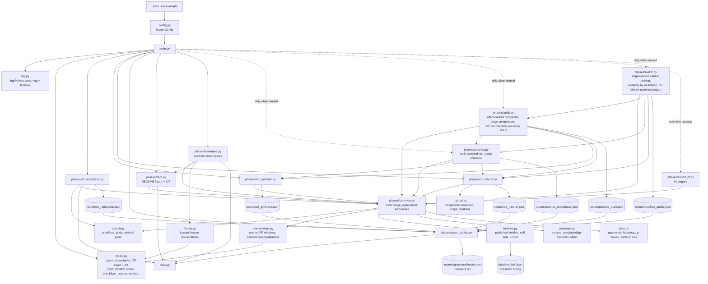

# Code architecture and data flow

`main.py` is the only entry point. It loads the configuration and the model once, then calls the phases in order.
- E1, E2 and E3 each write `results/<phase>.json`; E1 also draws its figures.
- `hero` writes the README figure and GIF.
- `examples` writes the example-swap figures and `reports/generated/examples.md` (output-only).
- `report` writes the generated tables, LaTeX macros and the E2/E3/summary figures from the JSONs.
- `posthoc`, `audit`, `audit2` and `export` run only when named. They write `results/posthoc_robustness.json`,
  `results/posthoc_audit.json`, `results/posthoc_audit2.json` and `hf_export/`.
- Library modules hold no experiment logic.

## What happens when you run `uv run python main.py`

1. **Config and logging.** `.env` is read, and the full config is logged to `logs/<timestamp>.log` and the terminal.
2. **Model.** Lucent's InceptionV1 is loaded. The weights (`inception5h.pth`, 28 MB) are downloaded once by
   torch.hub. Its `F.local_response_norm` calls are redirected to TF-exact constants.
3. **E1, observational replication (13 s including start-up).**
   - Render 1152 arcs and 1152 lines from the selection split.
   - Run them through the network and read `mixed3a`/`mixed3b` at (13,13) and `mixed4a` at (6,6).
   - Average activation per orientation to get tuning curves.
   - Fit one orientation convention on 3a, then correlate 3b and 4a with the published curves against a
     label-permutation null.
   - Compute each 3b unit's AUROC against other orientations and against lines.
4. **E2, synthetic interventions (about 40 minutes on an RTX 5070 Laptop).**
   - Render the selection and confirmatory splits and cache, per image, the 11×11×480 `mixed3b` window that feeds
     `mixed4a` unit (6,6).
   - Fit z-scores and decoder templates on the selection split.
   - For each neuron set (the family, Fisher top-10, the complement, all channels, and thousands of null sets),
     overwrite those channels in the base window with the source window's values.
   - Recompute only `maxpool4 → mixed4a` on the window, then decode the orientation.
   - Repeat the same machinery for the ridge readout, H2 (lines ↔ arcs), H4 (3a → 3b windows), the stability seeds
     and the Lucent-LRN model.
5. **E3, natural images (about 16 minutes).**
   - Download Imagenette-320 once (342 MB).
   - Composite arcs onto photo backgrounds and rerun H1.
   - For curve-present photos, use the rotated photo as the source (H5).
   - Mean-ablate the family over whole maps and count changes in the network's top-1 prediction.
6. **Hero.** Re-renders the selection and confirmatory splits and draws the README example figure and GIF for the
   pre-chosen cell (θ = 0° base, radius 45, width 3, dark-on-light).
7. **Examples (about 3 minutes on an RTX 5070 Laptop; log `20261024_024626`).**
   - Re-render the two splits, recompute the H1 family swap for all 4608 pairs and assert that the IIA equals
     `results/e2_synthetic.json`.
   - Draw 6 random successes and 3 random failures (`stats.random_rows`, seed 0), plus the hero pair.
   - Capture their full `mixed3b` maps, swap the family's 11×11 window, re-run `mixed4a` on the full maps, and
     assert that this equals the scored readout.
   - Render feature visualizations of the 24 curve units with Lucent (512 steps, redirected ReLU).
   - Draw one flow figure per pair, an overview, and the neuron grid, and write `reports/generated/examples.md`.
8. **Report.** Markdown tables (`reports/generated/results.md`), LaTeX macros, and the E2/E3 and summary figures
   are produced from the JSON files only.

## Design choices

- **Cropped-window recomputation.** Thousands of null sets × 4608 pairs would mean millions of full forward passes.
  We re-run only the block between the patched layer and the readout, on the receptive-field window.
  `tests/test_model.py` checks that this equals the full network in float64: it asserts ≤ 1e-9, and a re-check
  measured a difference of 0.
- **One generic experiment function.** `interchange_experiment` serves every hypothesis. Only the splits, pairs,
  family, readout and labels change, which keeps H1, H2, H4, H5 and the robustness runs comparable.
- **No hand-copied numbers.** Reports quote `reports/generated/results.md`, which `report_tables.py` writes from
  the JSONs.
