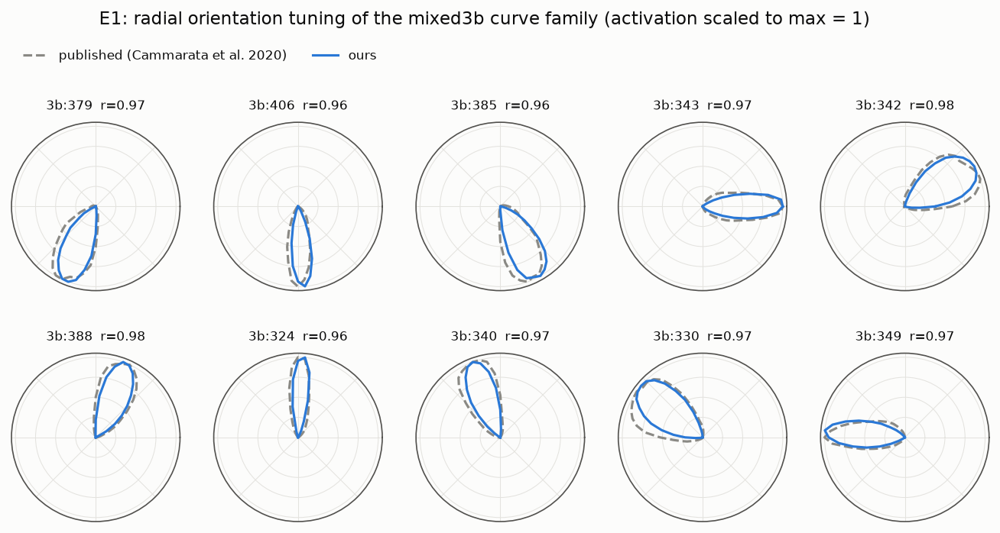
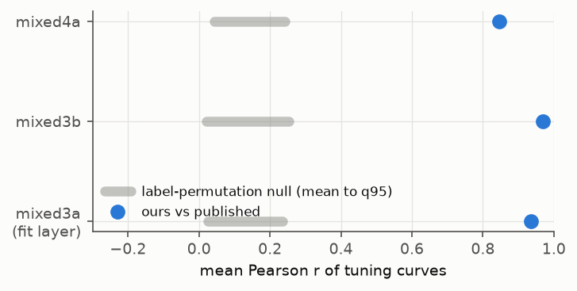

# E1: observational replication of the published curve-family tuning

**Question.** Does our setup reproduce the curve-family tuning the Circuits authors published? The setup is Lucent's
InceptionV1 with TF-exact LRN, our own arc renderer, and our readout positions. E1 is the gate for every
interventional result: if our setup did not reproduce the tuning, a failed swap could be an artefact.

**Data.** Selection split only (jitter seed 1): 1152 arcs and 1152 straight lines. All numbers below are from
`results/e1_replication.json`, also tabulated in `reports/generated/results.md`.

## Method
1. Record post-ReLU activations of every channel at the readout position: `mixed3a`/`mixed3b` at (13,13) and
   `mixed4a` at (6,6). All share the RF centre at pixel (111,111).
2. **Tuning curve** = mean activation per orientation θ (72 values), averaged over the 16 nuisance cells.
3. **Published curves:** 720 points at 0.5° steps, from `data/circuits/*.json`, subsampled to our 5° grid.
4. **Orientation convention:** one global reflection plus shift that maps our θ to the authors' angle. It is fitted
   **on mixed3a only** (2 × 72 candidates, maximising mean Pearson r), then applied unchanged to 3b and 4a.
5. **Null:** shuffle which published curve belongs to which unit (10,000 permutations) and recompute the mean r.
6. **Selectivity of each 3b unit (AUROC):**
   - Positives: arcs within ±45° of the unit's preferred θ.
   - Negatives: (a) arcs at other orientations; (b) straight lines with the same lengths, widths and polarities.
   - The gate metric, Pearson r, passes the neuron-explanation sanity checks of
     [Oikarinen et al. 2025](https://arxiv.org/abs/2506.05774). AUROC fails their extra-labels test, so it is
     reported only as a descriptive selectivity summary, not as evidence for the gate.

## Results
- **Convention fitted on 3a:** reflection −1, shift 180° (r = 0.937 on 3a). The same convention also maximised the
  fit separately on every layer in the pilot, so it is not tuned to 3b.
- **mixed3b: mean r = 0.969.** Every unit is in 0.96–0.98. Permutation null q95 = 0.254; p = 1·10⁻⁴, the minimum
  possible with 10⁴ permutations.
  - Preferred orientations, in our convention, tile the circle in the published order: 379 → 290°, 406 → 265°,
    385 → 240°, 343 → 180°, 342 → 150°, 388 → 110°, 324 → 95°, 340 → 70°, 330 → 40°, 349 → 5°.
- **mixed4a: mean r = 0.847** (null q95 0.242, p = 1·10⁻⁴). 12 of 14 units have r ≥ 0.73; the lowest of
  these is 4a:58 (r = 0.739). The exceptions are 4a:406 (r = 0.17) and 4a:95 (r = 0.44).
  - Cammarata et al. describe 4a:406 as detecting "tops of cups and pans viewed from an angle", which is an
    object-like unit, so a weak match to our clean arcs is plausible.
- **3b selectivity:**
  - AUROC vs other orientations: 0.70 (3b:324) to 0.95 (3b:342).
  - AUROC vs straight lines: 0.67 (3b:324) to 0.92 (3b:349).
  - Mean response to arcs near the preferred θ: 172–433. Mean response to lines: 0.6–58.
  - The units prefer curves to lines, but not perfectly. 3b:324 and 3b:406 are the least selective.

- **LRN sensitivity:** with Lucent's default LRN constants instead of the TF-exact ones, the same correlations are
  0.937 (3a), 0.969 (3b) and 0.848 (4a). The LRN fix does not affect tuning-curve shape.
  - This check was in the approved plan but is not in the pre-registration.
  - It was run after the confirmatory run, by rerunning E1 deterministically (`logs/20261023_191858.log`). The other
    E1 numbers are identical to the confirmatory log.

## Interpretation
- The port (Lucent and TF-exact LRN), the renderer and the readout positions reproduce the published tuning closely
  for 3a and 3b, and well for most 4a units, with either LRN variant.
- The observational part of the explanation (orientation tuning that tiles 360°) replicates. We therefore treat
  failures of the interventional tests (E2/E3) as properties of the network, not of the setup.
- The LRN-sensitivity run in E2 checks that conclusions do not hinge on the LRN fix.

## Learnings and issues
- **PIL draws an arc's stroke inside its bounding box**
  ([ImageDraw.arc](https://pillow.readthedocs.io/en/stable/reference/ImageDraw.html): "inside the given bounding
  box"), so a box of radius r puts the stroke's outer edge, not its centre line, at r.
  - Our first renderer put the stroke's outer edge, not its centre line, on the RF centre (`test_stimuli.py` caught
    this: centre-pixel coverage 0.5).
  - Fix: draw on a circle of radius r + w/2.
- **Lucent's LRN constants are not TF-exact.**
  - Lucent hard-codes size 9 and k = 1.
  - The TF graph uses depth_radius = 5 and bias = 2. Under
    [TF's formula](https://www.tensorflow.org/api_docs/python/tf/nn/local_response_normalization), that means a
    window of 11 and, for PyTorch, alpha × 11.
  - [lucent#51](https://github.com/greentfrapp/lucent/pull/51) itself (open, unmerged) proposes size 10 and k = 2.
    A third-party [comment](https://github.com/greentfrapp/lucent/pull/51#issuecomment-6345247394) in its
    discussion (2026-10-22) gives the size-11 values. It reports a largest normalised error of 6e-6 against the
    original graph run in TensorFlow 2.21.
  - We shim these constants in rather than forking Lucent. The LRN-sensitivity run above shows that the choice does
    not change the conclusions.
- **Radii {30, 45, 60, 80}** were chosen on the pilot split (seed 0). There 3b r = 0.965 / 0.968 / 0.959 / 0.933
  and 4a r = 0.756 / 0.819 / 0.849 / 0.850 (`pilot/pilot_tuning_radii.log`). Radius 10 gave 3b r = 0.88 and
  4a r = 0.61. No single radius is best for both layers: 3b peaks at 45 and 4a at 80.
- **Choosing the 3a layer for the convention fit** keeps the 3b and 4a correlations from being inflated by a fit on
  the same data (suggested in the design critique).
