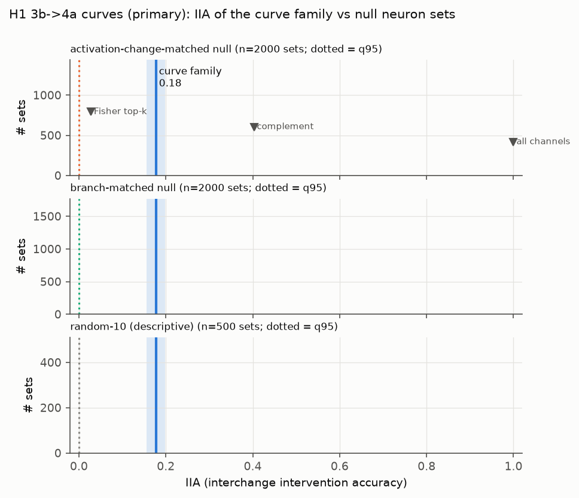
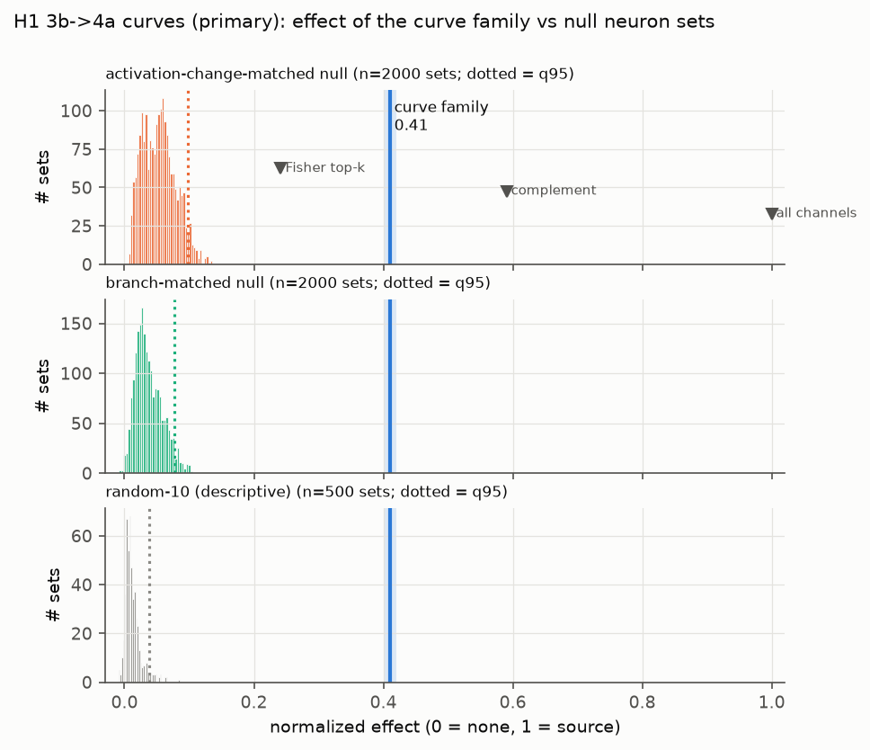
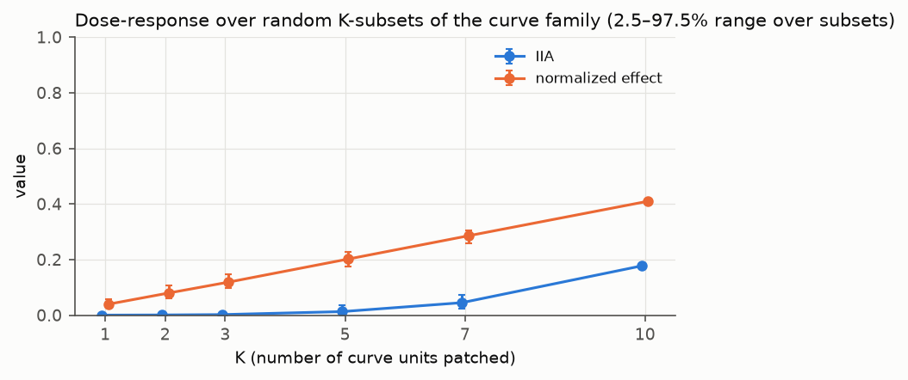
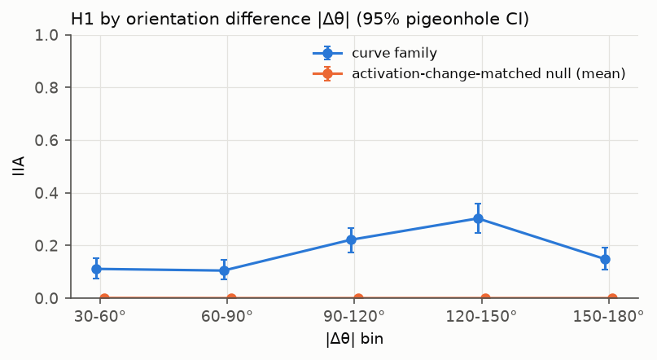

# E2: interchange interventions on synthetic stimuli

**Question.** Do the 10 `mixed3b` curve units *mediate* curve orientation for the next layer?

**Design.** Fixed in [`preregistration.md`](preregistration.md):
- 4608 confirmatory minimal pairs (jitter seed 2) that differ only in orientation.
- Swap the family's 11×11 receptive-field window from source to base and recompute `mixed4a`.
- Primary readout: the 14 published `mixed4a` curve units, decoded with a nearest-template decoder.
- Controls: 2000 activation-change-matched (Δ) and 2000 branch-matched null sets.

Numbers come from `results/e2_synthetic.json` and are tabulated in
[`generated/results.md`](generated/results.md). Brackets are 95% pigeonhole-bootstrap CIs.

## Pre-registered results

| Test | Readout | IIA family | Δ-null q95 (IIA) | Normalized effect family | Δ-null q95 (effect) | Verdict |
|---|---|---|---|---|---|---|
| **H1 (primary)** | 4a curve family | **0.177** [0.156, 0.199] | 0.001 | **0.410** [0.400, 0.420] | 0.098 | **falsified** (IIA < 0.2) |
| H1-ridge | ridge over all 508 4a channels | 0.105 [0.087, 0.123] | 0.000 | 0.248 | 0.106 | effect margin CI > 0 |
| H2 curvature (line ↔ arc) | 4a curve family | 0.405 [0.371, 0.440] | 0.054 | 0.393 | 0.141 | effect margin CI > 0 |
| H4 3a → 3b | 3b curve family | 0.058 [0.045, 0.071] | 0.005 | 0.324 | 0.169 | effect margin CI > 0 |

Secondary verdicts after Holm correction are in `generated/results.md`.

**Caveat on H1-ridge.** As pre-registered, its effect is the projection over all 508 z-scored `mixed4a` channels.
"Supported" therefore means the whole layer moves toward the source, not that the decoded orientation does.
Measured in the decoder's (cos, sin) output space (post-hoc), the effect is 0.573 against a null q95 of 0.126.

**A stricter null, checked post-hoc.** The decile-matched null partly flatters the family, which sits at the very
top of its decile. A rank-matched null and the top-10 non-family channels by Δ leave every conclusion unchanged:
H1 effect 0.410 against a rank-null q95 of 0.121, and the 10 most-changing non-family channels reach only 0.125.
The stronger competitor is the effect-ranked non-family set below (0.201). See
[`posthoc_robustness.md`](posthoc_robustness.md).

**Clean decoding** is near-perfect, so eligibility filtering hardly matters:
- H1: 0.996 (4574 of 4608 pairs eligible).
- Ridge and H2: 1.000.

**Permutation p-values** are at their floor: 1/(M+1) = 0.0005 with 2000 sets, 0.001 with 1000 (H2) and 0.002 with
500.

**Robustness**, H1 rerun with 500 null sets each:

| Run | IIA family | Effect family |
|---|---|---|
| jitter seed 3 | 0.172 | 0.410 |
| jitter seed 4 | 0.171 | 0.407 |
| Lucent default LRN | 0.172 | 0.406 |

Every verdict is unchanged.

## Reference sets (H1)

| Set | IIA | Effect |
|---|---|---|
| curve family (10) | 0.177 | 0.410 |
| Fisher top-10 for θ (data-driven; Jaccard with family 0.25) | 0.028 | 0.242 |
| complement (470) | 0.403 | 0.590 |
| all 480 | 1.000 | 1.000 |
| Δ-matched null (mean of 2000 sets) | 0.0001 | 0.053 |
| branch-matched null (mean of 2000 sets) | 0.0000 | 0.037 |

## Exploratory analyses (not pre-registered as tests)

- **IIA by |Δθ|:**

  | \|Δθ\| bin | IIA |
  |---|---|
  | 30–60° | 0.11 |
  | 60–90° | 0.10 |
  | 90–120° | 0.22 |
  | 120–150° | 0.30 |
  | 150–180° | 0.15 |

  The Δ-null mean is ≤ 0.0006 in every bin.
- **Dose-response over random K-subsets of the family.** The effect is almost exactly linear in K, about 0.04 per
  unit:

  | K | 1 | 2 | 3 | 5 | 7 | 10 |
  |---|---|---|---|---|---|---|
  | Effect | 0.040 | 0.080 | 0.119 | 0.202 | 0.285 | 0.410 |
  | IIA | 0.000 | 0.001 | 0.002 | 0.013 | 0.045 | 0.177 |

  IIA has a threshold shape: the decoder flips only once enough of the code has moved.
- **Top-K channels by activation change Δ.**

  | K | 10 | 20 | 40 | 80 | 160 |
  |---|---|---|---|---|---|
  | IIA | 0.10 | 0.36 | 0.44 | 0.79 | 0.98 |

  All 10 family units lie in Δ percentiles 96.5–99.4, inside the top 17 channels. The family is a better
  10-channel set than the top-10 by Δ (0.177 vs 0.103), but this ordering needs about 80 channels for IIA ≈ 0.8.
  Ranking channels by single-channel patching effect instead (post-hoc audit, below) gives IIA 0.485 / 0.693 /
  0.809 for the top 20 / 40 / 80. So IIA ≈ 0.5 takes 20–40 channels and IIA ≈ 0.8 still about 80. Both are fixed
  rankings by a per-channel score, not a search over sets, so these counts are upper bounds on the smallest
  sufficient set.
- **Mean ablation of the family.** The decoded base orientation survives in 0.806 of pairs. It survives in 0.985
  under Δ-matched null ablations (q05 0.964) and in 0.553 under complement ablation. Removing the family disrupts
  orientation decoding about 13× more often than removing matched channels (19.4% vs 1.5%). Against the stricter
  rank-matched null (post-hoc audit), the null retains 0.982 (q05 0.963), so the ratio is about 11× (19.4% vs 1.8%).
- **Same-orientation sham** (source = same θ, different jitter): base orientation retained in 0.999 of pairs. The
  patch itself does not corrupt the readout.
- **Closer to source than base:** 0.382 of pairs.
- **Family-rotation (activation-space) swap.** Each curve unit receives the map of the unit k steps around the
  orientation circle, with the base as donor.
  - The circular-mean shift points in the predicted direction for every k but reaches only 21–39% of the predicted
    angle. For example, k = 1 predicts −36° and observes −8°.
  - k = 5 is the exception at 62%: the prediction is ±180° and the observed shift is −112°.
  - The mean mixes outcomes rather than describing a uniform partial shift: 34–74% of pairs keep their decoded
    orientation, and 10–50% land within 30° of the predicted shift.
  - This matches partial mediation.
- **H2 is asymmetric.**
  - Line base with arc source: the 4a curve units read "arc" in 0.807 of pairs.
  - Arc base with line source: they read "line" in only 0.003 of pairs.
  - Each direction against its own Δ-matched null (1000 sets, post-hoc audit):
    - line → arc: null IIA mean 0.030, q95 0.114 (p = 0.001); effect 0.418 vs null q95 0.154.
    - arc → line: the effect is 0.367 vs null q95 0.130 (p = 0.001), although the decision flips almost never.
  - The decision is binary (line vs arc template), a lower bar than H1's 72-way decode.
  - The continuous effects are nearly symmetric (0.418 vs 0.367), so the IIA asymmetry comes from the correlation
    decoder, not the family. Measured along the line-to-arc direction, its boundary sits less than halfway from the
    line template: a 42% move flips most lines to "arc", but a 37% move leaves arcs on the arc side. Other channels
    also signal curvature, and that evidence stays in the arc base.
  - The line-vs-curve Fisher top-10 includes the double-curve unit 3b:359
    ([Early Vision](https://distill.pub/2020/circuits/early-vision/#group_mixed3b_double_curves)) and reaches only
    IIA 0.016.

## Interpretation
1. **The strong sufficiency claim fails.** Copying the 10 curve units makes the next layer's curve units decode the
   source orientation in only about 18% of pairs (10% under the whole-layer ridge readout). Under the pre-registered
   rule, H1 is falsified, robustly across seeds and LRN variants.
2. **The family is a highly specific causal mediator.**
   - The best of 4000 matched control sets of 10 channels transfers orientation in 0.13% of pairs (null q95 ≤ 0.001).
   - The family moves the 4a curve code 41% of the way to the source, versus a Δ-matched null q95 of 9.8%.
   - It is 2% of `mixed3b`'s channels yet carries about 41% of the readout displacement.
   - A causal, data-driven ranking recovers it (post-hoc audit). Ranking all 480 channels by single-channel
     patching effect on the selection split puts 9 of the 10 family units in the top 10. Unit 379 ranks 12th, and
     channel 380 takes its place. Channel 380 is itself a published curve-related unit: Early Vision lists 3b:359,
     337 and 380 as its mixed3b
     ["Double Curves" family](https://distill.pub/2020/circuits/early-vision/#group_mixed3b_double_curves).
   - That ranking uses the 14 curve readout units, which read `mixed3b` directly and plausibly use its curves
     ([Curve Circuits](https://distill.pub/2020/circuits/curve-circuits/) shows 3b curves feeding 4a shape detectors
     and notes 4a's curve detectors sit mostly in its 5×5 branch). Under the
     whole-layer ridge readout (third audit), 8 of the top 10 are family units; every family unit ranks within the
     top 24. The best 10 non-family channels there reach a (cos, sin) effect of 0.211, against the family's 0.573.
   - The 10 best *non-family* channels under that ranking reach effect 0.201 and IIA 0.001 on the confirmatory
     pairs. The family's margin over them is 0.209, CI [0.197, 0.221].
   - The observational Fisher top-10 (window centre only) is a much weaker competitor (IIA 0.028).
   - The family's ablation disrupts orientation 11–13× more often than matched ablations.
   - "Specific" here means relative to other `mixed3b` channels. A cross-nuisance sham (post-hoc audit) checks the
     concept side: copying the family from a stimulus with the same orientation but another radius, width or
     polarity leaves the decoded orientation intact in 99.2–99.9% of stimuli.
3. **The orientation code is shared, and whether the rest is redundant depends on the readout.**
   - For the 14 curve units, the complement alone moves the readout 59% of the way and transfers the decoded
     orientation in 40% of pairs. Reliable transfer (IIA ≈ 0.8) takes about 80 channels.
   - Under the pre-registered whole-layer ridge readout, the complement transfers the decoded orientation in only
     1.9% of pairs (family: 10.5%).
   - In that decoder's (cos, sin) output space, measured in the post-hoc audit, the family carries 0.573 of the
     displacement and the complement 0.427.
   - So the other 470 channels carry the rest of the signal, but they replace the family only for the curve-unit
     readout.
   - Effects are close to additive: family 0.410 + complement 0.590 = 1.000, and 0.573 + 0.427 = 1.000 in ridge
     output space.
   - This additivity is partly structural and partly empirical (third audit):
     - `maxpool4` acts per channel. In the 1×1 and pool branches of `mixed4a`, a linear 1×1 convolution follows.
       Effects there add exactly (non-additivity about 10⁻¹³). This covers 6 of the 14 readout units.
     - The 3×3 and 5×5 branches mix channels in a 1×1 bottleneck before a ReLU, so they are not additive by
       construction.
     - On these stimuli, swapping the family and the complement adds up to within 9.5% (3×3 branch) and 7.0%
       (5×5 branch), in squared norm. For the 8 readout units in the 5×5 branch it is within 1.8%.
     - The ridge decoder is linear, but half of its 508 inputs come from the non-additive branches.
   - This fits Gorton's finding of extra curve features outside the 10 neurons
     ([2024](https://arxiv.org/abs/2406.03662)).
4. **Curvature, not just orientation, is carried.** H2 shows that inserting the family's arc activations into a line
   image makes 4a read "arc" 81% of the time. Matched control sets do so in 3.0% on average (q95 11.4%). This
   favours "curve detector" over "oriented line detector" for what the family contributes downstream. The 81% vs
   0.3% split between directions is a decoder property; the family's effects in the two directions are 0.418 and
   0.367.
5. **The Curve Circuits claim (3a → 3b) shows the same pattern, more weakly.** The effect is above the matched nulls
   but IIA is only 0.058. The 3a family carries a small share of 3b's curve code: the complement reaches 0.757.

## Learnings and issues during E2
- **The pilot** (jitter seeds 0/100) already showed IIA ≈ 0.16 with null q95 ≈ 0.001. We kept the thresholds that
  were fixed before the pilot and disclosed the pilot numbers in the pre-registration, rather than lowering the IIA
  bar after seeing data.
- **Speed.** Recomputing the full network for 4500 null sets × 4608 pairs was infeasible. Re-running only the
  readout block on the 11×11 window made it possible: about 0.15 s per set with the decoder, with exactness proven
  in fp64.
- **GPU memory paging on the 8 GB WDDM GPU** made the first pilot crawl: CPU-bound, with CUDA spin-waits. py-spy
  showed the process blocked on GPU synchronisation. Fixes: gather only the patched source channels, call
  `empty_cache()` after full forward passes, and set the batch size to 64.
- **Quick-mode seeds overlapped the confirmatory seeds** in the first smoke test. We offset them (+100) before any
  E2 smoke run touched confirmatory data. One E1 smoke run on a selection-split subset is disclosed in the
  pre-registration.
- **Planned hypothesis H3 (locality) became unit tests.** For a single readout unit it is an architectural identity.
