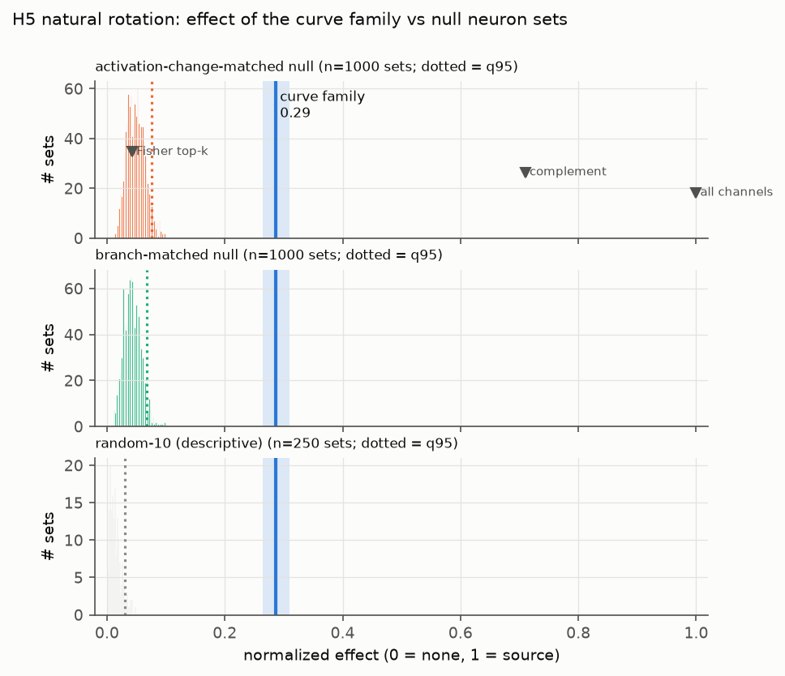

# E3: natural images (Imagenette)

**Question.** Does the curve family's causal role, as measured in E2, hold up under natural image statistics?

**Data.** The Imagenette-320 validation set: 3925 images
([TFDS catalog](https://www.tensorflow.org/datasets/catalog/imagenette)), split by seed into a 1963-image selection half and a
1962-image confirmatory half. Numbers are from `results/e3_natural.json`, tabulated in
[`generated/results.md`](generated/results.md).

## Experiments
1. **Composited arcs (H1 on natural backgrounds, secondary).**
   - The H1 arcs are alpha-composited onto Imagenette crops: one photo per nuisance cell, 2 replicates × 16 cells.
     Base and source still differ only in orientation.
   - Same decoder and readout as H1; 2 sources per base (4608 pairs); 1000 null sets per null.
2. **H5, natural rotation counterfactual (secondary).**
   - **Base:** a 224 crop whose pixel (111,111) is the photo's centre.
   - **Source:** the same photo rotated by φ ∈ {−90, −45, 45, 90, 180}° about that centre, before cropping, so no
     empty corners appear.
   - **Images used:** only "curve-present" crops, where the 3b family's max activation at the RF centre exceeds the
     selection-half 75th percentile (145.5). That leaves 506 confirmatory images and 2530 pairs.
   - **Readout:** which of the photo's 6 clean versions the patched 4a curve-family vector correlates with best. z
     statistics come from the selection half.
   - **Contrast (exploratory):** curve-absent crops, at or below the selection 25th percentile.
3. **Relevance (exploratory).**
   - Mean-ablate the family over the whole 28×28 `mixed3b` map, using the selection-half mean.
   - Run all 1962 confirmatory photos through the full network.
   - Count changes of the top-1 class among 1008, and compute KL(clean ‖ ablated).
   - Compare against 100 null ablations of 10 channels, matched to the family on activation variance.

## Results

| Test | IIA family | Δ-null q95 | Effect family | Δ-null q95 (effect) | Complement IIA / effect | Holm p | Verdict |
|---|---|---|---|---|---|---|---|
| Composited arcs | 0.190 [0.169, 0.211] | 0.001 | 0.415 [0.406, 0.425] | 0.104 | 0.435 / 0.586 | 0.004 | supported |
| H5 natural rotation | 0.072 [0.054, 0.091] | 0.000 | 0.287 [0.264, 0.310] | 0.075 | 0.847 / 0.710 | 0.004 | supported |

- **H5 IIA by rotation angle:**

  | Rotation | −90° | −45° | 45° | 90° | 180° |
  |---|---|---|---|---|---|
  | IIA | 0.077 | 0.030 | 0.030 | 0.081 | 0.140 |

- **H5 curve-absent contrast:** effect 0.135, IIA 0.017 (2585 pairs). That is about half the curve-present effect.
  No null sets were run on these crops, so this does not show that the family matters *more* when driven. Many
  curve-absent crops have exactly zero family response, so a smaller effect is expected mechanically.
- **Relevance:**
  - Top-1 prediction changes on **17.2%** of photos when the family is mean-ablated, against **9.3%** for matched
    null ablations (q95 11.0%, p = 0.0099).
  - Mean KL is 0.205 against 0.050 for the nulls (q95 0.069, p = 0.0099).
  - With 100 null sets, p = 1/101 is the smallest attainable p-value.
  - The null is matched in ablation size (post-hoc audit). The family's mean activation variance is 0.96 times that
    of the matched null sets, and its units sit at the 74th–94th variance percentiles. So the extra flips are not
    caused by the family's channels simply being larger.

**Caveats, checked post-hoc** (see [`posthoc_robustness.md`](posthoc_robustness.md)):
- **H5's clean accuracy (1.000) is automatic,** because each photo's own clean versions are its templates.
- **Interpolation blur does not matter.** PIL rotates ±45°, and ±90° on non-square images, bilinearly, while the 0°
  base and the 180° rotation are exact.
  - Repeating H5 on square crops with exact −90/90/180° transposes gives effect 0.336 (null q95 0.077) and IIA 0.108.
  - On the same three angles, the original rotations give 0.335 and 0.108: the difference is 0.000,
    CI [−0.001, 0.001] (third audit).
  - The lower pre-registered numbers (0.287, 0.072) come from the ±45° rotations, where the family transfers least.
    They also come from the two extra templates per photo, not from blur.
  - At ±45° blur cannot be removed, because no rotation by 45° is exact.
- **The composited test reuses the same 32 backgrounds in both splits,** so it generalises across jitter only.

## Interpretation
- **Composited arcs reproduce H1 almost exactly** (effect 0.415 vs 0.410; IIA 0.190 vs 0.177). Natural clutter around
  the curve does not change how much of the 4a curve code the family carries.
- **On natural photos the family is again specific but small in sufficiency.**
  - Copying it from the rotated photo moves the 4a curve code 29% of the way toward the rotated version (null q95
    7.5%). The readout picks the rotated version in only 7% of pairs.
  - The complement, which carries everything else that changed (texture, edges, colour layout), dominates at 85%.
  - This is expected: rotating a photo changes much more than curve orientation.
- **End to end, the family is relevant to the network's decisions.** Ablating these 10 of 480 `mixed3b` channels
  changes the 1008-way prediction about 1.8 times as often as ablating matched channels (17.2% vs 9.3%).
  - This is relevance, not orientation-specific evidence.
  - It is in line with the preliminary removal experiment of
    [Cammarata et al. 2021](https://distill.pub/2020/circuits/curve-circuits/): removing the 3b curve detectors
    lowered top-5 accuracy on 2000 ImageNet validation images from 88.6% to 86.3%. That experiment had no matched
    null.
  - It agrees with the ablation-based relevance criteria of recent vision-unit work
    ([Aguilar Canto et al. 2026](https://icml.cc/virtual/2026/79523), ICML 2026 Mechanistic Interpretability
    Workshop; [Bau et al. 2020](https://doi.org/10.1073/pnas.1907375117)).

## Learnings and issues
- **Imagenette** was chosen over ImageNet because it downloads without a login (342 MB) and is the standard
  [fast.ai subset](https://github.com/fastai/imagenette).
  - We compare predictions with the network's own clean predictions. This avoids mapping Imagenette labels onto
    Lucid's 1008-class label order.
  - Pixels are never redistributed.
- **"Curve-absent" initially selected zero images.** Many crops have exactly zero family response because of the
  ReLU, so `< q25` was empty. We changed it to `≤ q25` before the confirmatory run (it is an exploratory contrast).
- **Rotation geometry.** The shorter side is resized to 332 px, so a 224 crop rotated by any angle stays inside the
  image: 112·√2 ≈ 158 < 166.
